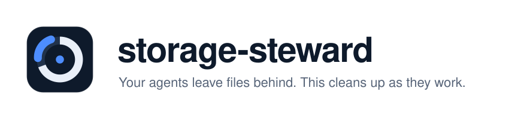
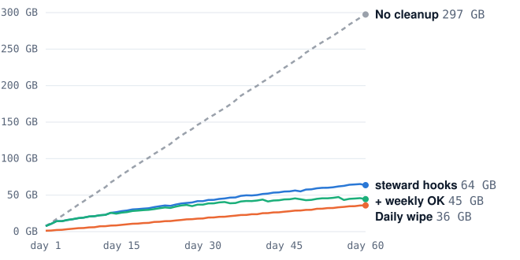

<p align="center">
  <picture>
    <source media="(prefers-color-scheme: dark)" srcset="assets/banner-dark.svg">
    
  </picture>
</p>

<p align="center">
  <a href="https://github.com/deaglecodes/storage-steward/actions/workflows/tests.yml"></a>
  
  
  
  
  <a href="LICENSE"></a>
</p>

<p align="center"><b><a href="https://deaglecodes.github.io/storage-steward/">Website</a></b> · <a href="https://deaglecodes.github.io/storage-steward/benchmarks.html">Benchmarks</a> · <a href="#install">Install</a> · <a href="#how-it-works">How it works</a></p>

---

**storage-steward** is an [Agent Skill](https://agentskills.io) that cleans up after coding agents while they
work. It works with Claude Code, Codex, Cursor, Gemini CLI, OpenCode, Copilot CLI, or anything else that
reads `SKILL.md`. It runs from background hooks (or an OS timer), so it costs zero tokens per prompt, and it
never deletes anything you'd miss. You stop having to clear disk space every morning.

| Agent | Skill location | Automatic cleanup |
|---|---|---|
| Claude Code | `~/.claude/skills` (symlink) | hooks: `UserPromptSubmit`, `Stop`, `SessionEnd` |
| Codex | `~/.agents/skills` | hooks: `UserPromptSubmit`, `Stop` |
| Cursor | `~/.cursor/skills` (symlink) | hooks: `stop`, `sessionEnd` |
| Gemini CLI / Antigravity | `~/.gemini/skills` (symlink) | hooks: `BeforeAgent`, `AfterAgent`, `SessionEnd` |
| OpenCode, Copilot CLI, Aider, others | `~/.agents/skills` or a symlink | `--schedule`: launchd / systemd / cron, every 3 h |

There is only one real copy on disk; every other agent gets a symlink, as you'd expect from a storage tool.

### Why

Coding agents write a lot to disk, and nothing cleans it up:

- **Background task output** in `/private/tmp/claude-<uid>` has no size cap and is never deleted. Single
  sessions have written [278 GB](https://github.com/anthropics/claude-code/issues/41737),
  [537 GB](https://github.com/anthropics/claude-code/issues/26911) and
  [771 GB](https://github.com/anthropics/claude-code/issues/46479).
- **Each Claude desktop task** copies `~/.claude` (about 300 MB) and keeps the copy
  ([#92158](https://github.com/anthropics/claude-code/issues/92158)). The usual fix, `rm -rf local_*`, also
  deletes your Cowork deliverables.
- **History grows without limit:** transcripts, rewind snapshots and debug logs in Claude Code
  ([#24207](https://github.com/anthropics/claude-code/issues/24207)), session history in Codex
  ([#42648](https://github.com/openai/codex/issues/42648)).
- **Every agent worktree** gets its own `node_modules`.

## Results

60 simulated days of a heavy Claude Code, Claude desktop and Codex user, replayed on real files with the
real skill code:

<p align="center">
  <picture>
    <source media="(prefers-color-scheme: dark)" srcset="assets/chart-dark.svg">
    
  </picture>
</p>

| Approach | Disk used, day 60 | Saved | Cache re-downloads | Deliverables lost |
|---|---:|---:|---:|---:|
| No cleanup | 297 GB | — | 0 | 0 |
| Manual daily wipe | 36 GB | 88% | 878 (41.8 GB) | **104 / 104** |
| **storage-steward hooks** | 64 GB | **79%** | **1** | **0** |
| **hooks + weekly OK** | 45 GB | **85%** | **1** | **0** |

The daily wipe saves a little more space, but it re-downloads 42 GB of caches and deletes every file made in
a Cowork session. With runaway task output (seen in the GitHub reports), no cleanup reaches **1,001 GB**,
more than a 1 TB Mac holds, and storage-steward saves 94–96%.

When an agent does the cleanup itself, the skill makes it cheaper. Each task ran in a disposable sandbox,
twice with the skill and twice without:

| Task | Tokens with skill | Without | Time |
|---|---:|---:|---:|
| "Free up space, don't delete anything I'd miss" | **26.3k** | 63.2k (−58%) | 38 s vs 197 s |
| "Make cleanup automatic" | **30.6k** | 212.8k (−86%) | 96 s vs 797 s |

Token counts exclude the 103k tokens every subagent spends before it starts. Runs with the skill passed
every check; runs without passed 96%. The full method and caveats are in the
[benchmark report](https://deaglecodes.github.io/storage-steward/benchmarks.html).

## Install

You need Python 3.9 or newer and at least one coding agent. There are no other dependencies.

```bash
git clone https://github.com/deaglecodes/storage-steward
```

```bash
./storage-steward/install.sh --dry-run
```

```bash
./storage-steward/install.sh --retention 21
```

The installer finds the agents on your machine and puts one copy of the skill in `~/.agents/skills`, with
symlinks for the others. It backs up each agent's config, adds that agent's hooks, and checks that every
hook answers in the format its agent expects. The check does not start a sweep. `--dry-run` lists what would
change. Other options:

- `--agents claude,codex` limits the install to the agents you name.
- `--schedule` adds an OS timer for agents without hooks.
- `--retention` sets Claude Code's built-in transcript retention (`cleanupPeriodDays`).

To see what it would reclaim right now, run a dry run. It changes nothing:

```bash
python3 ~/.agents/skills/storage-steward/scripts/steward.py scan
```

You can also just ask your agent *"why is my disk full?"*; the skill is picked up from that.

## How it works

| When | What happens | Cost |
|---|---|---|
| **While the agent works** | The skill gives agents five habits: one scratch folder per task; no background output allowed to grow without limit; APFS `cp -c` clones of `node_modules` for worktrees; a free-space check before writes over 1 GB; streaming instead of saving large intermediate files. | about 1.8k tokens, only when the skill loads |
| **Every prompt** | A prompt hook (`UserPromptSubmit`, or `BeforeAgent` in Gemini) checks free space. It adds a warning only below max(20 GiB, 5%). Otherwise it prints nothing, or `{}` where the agent requires JSON. | 0 tokens, about 60 ms |
| **After a session** | Stop/end hooks start a sweep of the **auto** tier in the background, at most every 3 hours (immediately when disk is low). Agents without hooks get the same sweep from an OS timer. | 0 tokens, the agent never waits |
| **When it matters** | Items in the **confirm** tier are listed with their sizes. Only the ones you approve are removed (`--only rule`). | your call |

**Tiers**

- **auto** (swept without asking): idle task output, plugin copies inside idle desktop sandboxes, debug logs
  older than 7 days, rewind snapshots older than 30 days, stale npx/uv/pip caches, Xcode DerivedData,
  updater leftovers, `$TMPDIR` entries older than 7 days.
- **confirm** (needs your OK): transcripts and Codex sessions older than 30 days, clean agent worktrees,
  `node_modules`/`.venv` of projects idle for 30+ days, old Playwright browsers, Docker build cache.
- **info** (reported, never touched): local models, the Cowork VM image, Codex databases, your Cowork
  outputs, the Trash.

**Second-chance eviction.** Tools read caches without writing them, so a cache entry you use every day can
look a month old by its modification time. macOS (APFS) and Linux (`relatime`) update a file's access time
only when it is older than the modification time. storage-steward uses that rule:

1. A stale entry is "armed": its access time is set just below its modification time.
2. If anything reads the entry, its access time moves forward, and the entry is kept.
3. If nothing reads it for 7 days, it is deleted.

In the benchmark, this avoided 33–35 cache re-downloads for about 2 GB of extra disk.

## Commands

```text
steward.py status                 one line: free space, flags LOW
steward.py scan                   dry run, grouped by tier (~15 lines max)
steward.py sweep                  reclaim the auto tier
steward.py sweep --tier confirm --only RULE[,RULE] --yes
steward.py report                 total reclaimed so far
steward.py install [--agents LIST] [--schedule] [--dry-run] / uninstall
steward.py schedule install|uninstall|status
```

Each command prints at most about 15 lines, so an agent never has to read thousands of lines of `du` output.

## Safety

These rules are enforced in code and covered by 17 unit tests. storage-steward never:

- empties your Trash (that's a permanent delete you should make yourself)
- touches `Documents`, `Desktop`, `Downloads`, credentials, `settings.json`, memory or skills
- deletes anything written in the last hour (re-checked just before each delete)
- touches the running session (`CLAUDE_CODE_SESSION_ID`) or its desktop sandbox
- removes a worktree with uncommitted changes
- follows a symlink outside its folder, or deletes anything outside its rule's root
- deletes your Cowork `outputs/` or `uploads/`
- runs Docker, Homebrew, uv or pnpm prune commands when pointed at a test sandbox (`--home`)

## FAQ

<details><summary><b>Which agents does it work with?</b></summary>

Any agent that reads `SKILL.md` can use the skill. The installer adds hooks for Claude Code, Codex, Cursor
and Gemini CLI/Antigravity, each in that agent's own format, and `--schedule` covers everything else. The
cleanup rules include Claude, Codex, Cursor, Gemini, OpenCode and Copilot leftovers, plus the dev caches
they all fill.
</details>

<details><summary><b>Will it delete my transcripts?</b></summary>

Not on its own. Transcripts older than 30 days are a confirm-tier item. `--retention` sets Claude Code's own
`cleanupPeriodDays`; leave it out to keep the 30-day default.
</details>

<details><summary><b>How do I uninstall it?</b></summary>

Run `python3 ~/.agents/skills/storage-steward/scripts/steward.py uninstall`. It removes only its own hooks
from every agent, plus the OS timer if you added one. Each install also saves a backup next to every config
file it edits.
</details>

## Reproduce the benchmarks

```bash
python3 -m unittest discover tests -v
```

```bash
python3 bench/simulate.py --days 60 --seed 7 --workdir /tmp/ss-sim --out bench/results/sim_typical_s7.json
```

```bash
python3 bench/simulate.py --days 60 --seed 7 --runaway --workdir /tmp/ss-sim --out bench/results/sim_runaway_s7.json
```

```bash
python3 bench/build_site.py
```

`bench/make_fixture.py` builds the fake Mac home used for the token evals. It includes traps: deliverables,
a dirty worktree, an active project, the live session, and Documents and Downloads. `bench/grade_evals.py`
grades the runs. Aggregate results are in `bench/results/`.

## License

MIT. See [LICENSE](LICENSE).
