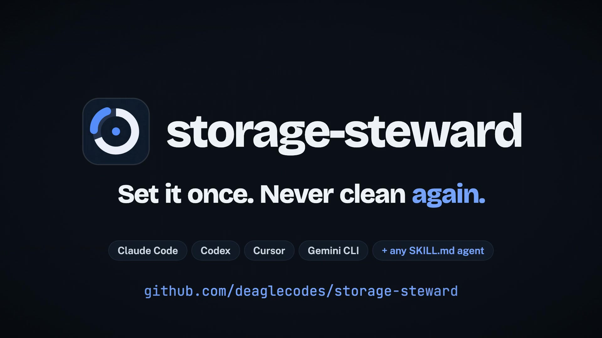

<p align="center">
  <picture>
    <source media="(prefers-color-scheme: dark)" srcset="assets/banner-dark.svg">
    
  </picture>
</p>

<p align="center">
  <a href="https://github.com/deaglecodes/storage-steward/actions/workflows/tests.yml"></a>
  
  
  
  
  <a href="LICENSE"></a>
</p>

<p align="center"><b><a href="https://deaglecodes.github.io/storage-steward/">Website</a></b> · <a href="https://deaglecodes.github.io/storage-steward/benchmarks.html">Benchmarks</a> · <a href="#install">Install</a> · <a href="#how-it-works">How it works</a></p>

---

**storage-steward** is an [Agent Skill](https://agentskills.io) that cleans up after coding agents while they
work. It works with Claude Code, Codex, Cursor, Gemini CLI, OpenCode, Copilot CLI, or anything else that
reads `SKILL.md`. It runs from background hooks (or an OS timer), so it costs zero tokens per prompt, and it
never deletes anything you'd miss. You stop having to clear disk space every morning.

<p align="center"><a href="https://deaglecodes.github.io/storage-steward/#film"></a><br><sub>▶ <a href="https://deaglecodes.github.io/storage-steward/#film">Watch the 45-second launch film</a> (made with the <a href="https://github.com/Rieranthony/product-film-skill">product-film</a> skill)</sub></p>

| Agent | Skill location | Automatic cleanup |
|---|---|---|
| Claude Code | `~/.claude/skills` (symlink) | hooks: `UserPromptSubmit`, `Stop`, `SessionEnd` |
| Codex | `~/.agents/skills` | hooks: `UserPromptSubmit`, `Stop` |
| Cursor | `~/.cursor/skills` (symlink) | hooks: `stop`, `sessionEnd` |
| Gemini CLI / Antigravity | `~/.gemini/skills` (symlink) | hooks: `BeforeAgent`, `AfterAgent`, `SessionEnd` |
| OpenCode, Copilot CLI, Aider, others | `~/.agents/skills` or a symlink | `--schedule`: launchd / systemd / cron, every 3 h |

There is only one real copy on disk; every other agent gets a symlink, as you'd expect from a storage tool.

### Why

Coding agents write a lot to disk, and nothing cleans it up:

- **Background task output** in `/private/tmp/claude-<uid>` has no size cap and is never deleted. Single
  sessions have written [278 GB](https://github.com/anthropics/claude-code/issues/41737),
  [537 GB](https://github.com/anthropics/claude-code/issues/26911) and
  [771 GB](https://github.com/anthropics/claude-code/issues/46479).
- **Each Claude desktop task** copies `~/.claude` (about 300 MB) and keeps the copy
  ([#92158](https://github.com/anthropics/claude-code/issues/92158)). The usual fix, `rm -rf local_*`, also
  deletes your Cowork deliverables.
- **History grows without limit:** transcripts, rewind snapshots and debug logs in Claude Code
  ([#24207](https://github.com/anthropics/claude-code/issues/24207)), session history in Codex
  ([#42648](https://github.com/openai/codex/issues/42648)).
- **Every agent worktree** gets its own `node_modules`.

## Results

60 simulated days of a heavy Claude Code, Claude desktop and Codex user, replayed on real files with the
real skill code:

<p align="center">
  <picture>
    <source media="(prefers-color-scheme: dark)" srcset="assets/chart-dark.svg">
    
  </picture>
</p>

| Approach | Disk used, day 60 | Saved | Cache re-downloads | Deliverables lost |
|---|---:|---:|---:|---:|
| No cleanup | 294 GB | — | 0 | 0 |
| Manual daily wipe | 33 GB | 89% | 878 (41.8 GB) | **104 / 104** |
| **storage-steward hooks** | 61 GB | **79%** | **1** | **0** |
| **hooks + weekly OK** | 44 GB | **85%** | **1** | **0** |

The daily wipe saves a little more space, but it re-downloads 42 GB of caches and deletes every file made in
a Cowork session. With runaway task output (seen in the GitHub reports), no cleanup reaches **998 GB**, a full
1 TB Mac, and storage-steward saves 94–96%.

When an agent does the cleanup itself, the skill makes it cheaper. Each task ran in a disposable sandbox,
twice with the skill and twice without:

| Task | Tokens with skill | Without | Time |
|---|---:|---:|---:|
| "Free up space, don't delete anything I'd miss" | **26.3k** | 63.2k (−58%) | 38 s vs 197 s |
| "Make cleanup automatic" | **30.6k** | 212.8k (−86%) | 96 s vs 797 s |

Token counts exclude the 103k tokens every subagent spends before it starts. Runs with the skill passed
every check; runs without passed 96%. The full method and caveats are in the
[benchmark report](https://deaglecodes.github.io/storage-steward/benchmarks.html).

## Install

You need Python 3.9 or newer (the `python3` that ships with macOS is fine) and at least one coding agent.
There are no other dependencies.

```bash
git clone https://github.com/deaglecodes/storage-steward && cd storage-steward
```

See what the installer would change. This writes nothing:

```bash
./install.sh --dry-run
```

Then install:

```bash
./install.sh
```

The installer finds the agents on your machine and puts one copy of the skill in `~/.agents/skills`, with
symlinks for the others. It backs up each agent's config, adds that agent's hooks, and checks that every
hook answers in the format its agent expects. The check does not start a sweep. To update, `git pull` and
run `./install.sh` again; it replaces the old copy. Options:

- `--agents claude,codex` limits the install to the agents you name.
- `--schedule` adds an OS timer for agents without hooks.
- `--retention 21` also sets Claude Code's own transcript retention (`cleanupPeriodDays`), so Claude Code
  deletes transcripts older than 21 days instead of 30. It's off unless you ask, and uninstall reverts it.

Before you let it delete anything, see exactly what it would remove right now. Neither command changes
anything:

```bash
python3 ~/.agents/skills/storage-steward/scripts/steward.py scan
```

```bash
python3 ~/.agents/skills/storage-steward/scripts/steward.py scan --paths
```

You can also just ask your agent *"why is my disk full?"*; the skill is picked up from that. In the rest of
this README, `steward.py` is short for `python3 ~/.agents/skills/storage-steward/scripts/steward.py`.

### Uninstall

```bash
python3 ~/.agents/skills/storage-steward/scripts/steward.py uninstall
```

This removes the hooks from every agent, the skill and its links, the OS timer if you added one, and the
`--retention` setting if it set one. Your policy (`~/.config/storage-steward`) and the log of what was removed
(`~/.cache/storage-steward`) stay; run `uninstall --purge` instead to remove them too (or, after an
uninstall, `python3 storage-steward/scripts/steward.py uninstall --purge` from your clone).

## How it works

| When | What happens | Cost |
|---|---|---|
| **While the agent works** | The skill gives agents five habits: one scratch folder per task; no background output allowed to grow without limit; APFS `cp -c` clones of `node_modules` for worktrees; a free-space check before writes over 1 GB; streaming instead of saving large intermediate files. | about 1.8k tokens, only when the skill loads |
| **Every prompt** | A prompt hook (`UserPromptSubmit`, or `BeforeAgent` in Gemini) checks free space. It adds a warning only below max(20 GiB, 5%). Otherwise it prints nothing, or `{}` where the agent requires JSON. | 0 tokens, about 60 ms |
| **After a session** | Stop/end hooks start a sweep of the **auto** tier in the background, at most every 3 hours (immediately when disk is low). Agents without hooks get the same sweep from an OS timer. | 0 tokens, the agent never waits |
| **When it matters** | Items in the **confirm** tier are listed with their sizes. Only the ones you approve are removed (`--only rule`). | your call |

**Tiers**

- **auto** (swept without asking): idle task output and session temp folders, plugin copies inside idle
  desktop sandboxes, debug logs and shell snapshots older than 7 days, rewind snapshots older than 30 days,
  Codex/OpenCode/Cursor temp files and logs, stale npx and pip caches, Xcode DerivedData, updater leftovers,
  `$TMPDIR` entries older than 7 days (not ones holding a live socket), and the tools' own prune commands:
  `brew cleanup --prune=14`, `uv cache prune`, `pnpm store prune`.
- **confirm** (needs your OK): transcripts and Codex sessions older than 30 days, clean agent worktrees,
  `node_modules`/`.venv` of projects idle for 30+ days, old Playwright browsers, Docker build cache.
- **info** (reported, never touched): local models, the Cowork VM image, Codex databases, your Cowork
  outputs, the Trash.

**Second-chance eviction.** Tools read caches without writing them, so a cache entry you use every day can
look a month old by its modification time. macOS (APFS) and Linux (`relatime`) update a file's access time
only when it is older than the modification time. storage-steward uses that rule:

1. A stale entry is "armed": its access time is set just below its modification time.
2. If anything reads the entry, its access time moves forward, and the entry is kept.
3. If nothing reads it for 7 days, it is deleted.

In the benchmark, this avoided 33–35 cache re-downloads for about 2 GB of extra disk.

## Make it yours

Every rule's tier and age threshold is a default you can change. You can also protect anything, or add
your own folders to clean. Ask your agent in plain English ("never delete my transcripts") and the skill
runs the right command, or run it yourself:

```bash
steward.py config set claude-transcripts --tier off         # never touch them
steward.py config set claude-task-output --idle 6h           # clear task output after 6 hours
steward.py config set codex-sessions --tier auto --idle 45d  # stop asking, just do it
steward.py config keep ~/models '*.mov'                      # never delete these, whatever the rule
steward.py config add work-builds --path '~/work/*/build' --idle 7 --tier auto
steward.py rules                                             # the effective policy
```

The policy lives in `~/.config/storage-steward/config.json`:

```json
{
  "rules": { "claude-transcripts": { "tier": "off" }, "claude-task-output": { "idle_days": 0.25 } },
  "keep": ["~/models", "*.mov"],
  "custom": [{ "name": "work-builds", "paths": ["~/work/*/build"], "idle_days": 7, "tier": "auto" }],
  "sweep_every_hours": 3, "warn_below_gb": 20
}
```

**Tiers:**
- `auto`: the hooks sweep it.
- `confirm`: asks first.
- `info`: reported only.
- `off`: ignored.

**Guard rails:**
- `keep` beats every rule. A path keeps everything under it; a name pattern like `*.mov` (any case) also
  keeps any folder that contains a match.
- Custom rules must name a folder below `~`, without `..`.
- Nothing inside Documents, Desktop, Downloads, Pictures, Movies or Music is ever swept automatically,
  whatever a rule's tier says. Rules there are capped at `confirm`.
- A broken config file never breaks a hook. It pauses deletes until you fix it (`scan` says why), because
  a keep list that can't be read can't protect anything. A typo in one rule switches that rule off.

## Commands

```text
steward.py status                 one line: free space, flags LOW
steward.py scan                   dry run, grouped by tier (~15 lines)
steward.py scan --paths           dry run, every path a sweep would remove
steward.py sweep                  reclaim the auto tier
steward.py sweep --tier confirm --only RULE[,RULE] --yes
steward.py report                 total reclaimed so far, and where the removal log is
steward.py install [--agents LIST] [--schedule] [--retention DAYS] [--dry-run]
steward.py uninstall [--purge]
steward.py schedule install|uninstall|status
steward.py rules [--json]         the effective policy, one line per rule
steward.py config set|unset|keep|unkeep|add|drop|show
steward.py --version
```

Output stays short (`status` is one line, `scan` about 15), so an agent never has to read thousands of lines
of `du` output.

## Safety

These rules are enforced in code, at the moment of each delete, whatever a rule or your config says.
The unit tests in [`tests/`](tests) cover each one, including the ways reviewers found to get around them.
storage-steward never:

- empties your Trash (that's a permanent delete you should make yourself)
- sweeps anything inside Documents, Desktop, Downloads, Pictures, Movies or Music on its own. Only a
  confirm-tier rule you approve can reach in there, and `scan --paths` lists those paths first.
- touches credentials (`~/.ssh`, `~/.gnupg`, `~/.aws`, the Keychain), your agents' settings and
  instructions (`settings.json`, `CLAUDE.md`, `AGENTS.md`, rules, hooks), memory or skills, or anything
  inside them, even when a rule you or an agent wrote points there
- deletes anything written in the last hour (re-checked just before each delete)
- touches the running session (`CLAUDE_CODE_SESSION_ID`) or its desktop sandbox
- removes a worktree unless git shows nothing would be lost: no uncommitted or untracked files, no ignored
  files beyond build output (an ignored `.env` counts as yours), and no commits that exist on no branch
- follows a symlink outside its folder, or deletes anything outside its rule's root, however the path is
  spelled (guards compare files by identity, so case, `..` and `//` don't matter)
- deletes your Cowork `outputs/` or `uploads/`
- deletes anything while your config file can't be read
- runs Docker, Homebrew, uv or pnpm prune commands when pointed at a test sandbox (`--home`)

Every path it removes is logged to `~/.cache/storage-steward/removed.log`.

## FAQ

<details><summary><b>Which agents does it work with?</b></summary>

Any agent that reads `SKILL.md` can use the skill. The installer adds hooks for Claude Code, Codex, Cursor
and Gemini CLI/Antigravity, each in that agent's own format, and `--schedule` covers everything else. The
cleanup rules include Claude, Codex, Cursor, Gemini, OpenCode and Copilot leftovers, plus the dev caches
they all fill.
</details>

<details><summary><b>Will it delete my transcripts?</b></summary>

Not on its own. Transcripts older than 30 days are a confirm-tier item. `--retention` sets Claude Code's own
`cleanupPeriodDays`; it's off unless you pass it, and uninstall reverts it.
</details>

<details><summary><b>How do I see what it removed?</b></summary>

`steward.py report` shows the total reclaimed. Every removed path is listed, with its rule, size and time,
in `~/.cache/storage-steward/removed.log`. To see what a sweep would remove before it runs, use
`steward.py scan --paths`.
</details>

<details><summary><b>How do I uninstall it?</b></summary>

See [Uninstall](#uninstall). Each install also saves a backup next to every config file it edits (the two
newest are kept).
</details>

## Reproduce the benchmarks

```bash
python3 -m unittest discover tests -v
```

```bash
for seed in 7 11 23; do python3 bench/simulate.py --days 60 --seed $seed --workdir /tmp/ss-sim --out bench/results/sim_typical_s$seed.json; done
```

```bash
python3 bench/simulate.py --days 60 --seed 7 --runaway --workdir /tmp/ss-sim --out bench/results/sim_runaway_s7.json
```

```bash
python3 bench/build_results.py && python3 bench/make_readme_chart.py && python3 bench/build_site.py
```

`bench/build_results.py` turns those four runs into the data behind the charts, the website and the benchmark
report. Each 60-day run takes a few minutes.

`bench/make_fixture.py` builds the fake Mac home used for the token evals. It includes traps: deliverables,
a dirty worktree, an active project, the live session, and Documents and Downloads. `bench/grade_evals.py`
grades the runs. Aggregate results are in `bench/results/`.

## Feedback

Found a bug or a leftover it should know about? [Open an issue](https://github.com/deaglecodes/storage-steward/issues).
If it ever deleted something it shouldn't have, please report it privately as described in
[SECURITY.md](SECURITY.md). What changed in each version is in [CHANGELOG.md](CHANGELOG.md).

## License

MIT. See [LICENSE](LICENSE).
